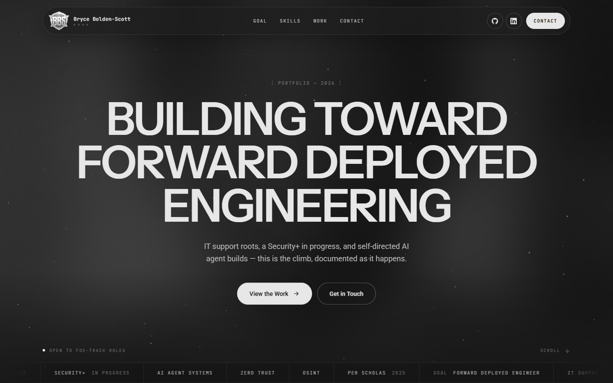

# bryceboldenscott.com

Overview of my portfolio site, [bryceboldenscott.com](https://bryceboldenscott.com).

> **Showcase only.** The site's source and deployment stay private. This repo describes how it's built, with one self-contained sample. Not accepting contributions.



## How it's built

- **Single file, no framework:** markup, CSS and JavaScript in one page, with nothing to build
- **Motion:** Lenis smooth scroll + GSAP ScrollTrigger (pinned, notch-stepped method panels, scroll-scrubbed reveals), a canvas particle field, and film grain as a single inline SVG
- **Design:** a composite of three reference sites, rebuilt from their real stylesheets and renders rather than from screenshots. Neutral grayscale, with Instrument Sans for display, Roboto for body text, and Geist / JetBrains Mono for labels
- **Responsive:** checked at 390 → 1440 px with no horizontal overflow, and every change verified in headless-browser renders before shipping
- **Accessibility and performance:** `prefers-reduced-motion` respected, off-screen animation paused, heavy scripts deferred

## Hosting and the contact pipeline

Served by a Cloudflare Worker with static assets. The Worker only runs for `POST /api/contact` (sample: [`examples/contact-worker.js`](examples/contact-worker.js)):

```
browser form ──▶ Worker /api/contact
                   ├─ honeypot check
                   ├─ Turnstile siteverify (server-side, with client IP)
                   ├─ field + attachment validation
                   └─ mail API ──▶ inbox   (voice notes travel as attachments)
```

The captcha is verified server-side, so a forged token gets a 403. Mail credentials live only in Worker secrets; the browser never talks to the mail provider, and voice recordings are never stored.

## Security headers

A strict Content-Security-Policy allowlist, `X-Frame-Options: DENY`, `nosniff`, HSTS, a referrer policy and a permissions policy. Every new third-party origin has to be added explicitly.

## Built with Claude Code + BASE

Designed and built with [Claude Code](https://claude.com/claude-code). The rebuild ran through 20 tracked versions under [BASE](https://github.com/bryceboldenscott/base), my ExecutionOS project-tracking skill, from content strategy through production deploy.

---

Bryce Bolden-Scott · [bryceboldenscott.com](https://bryceboldenscott.com)
